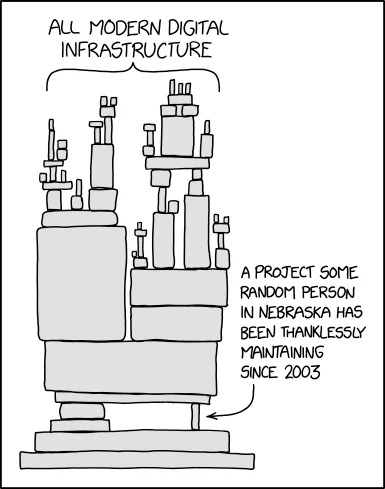
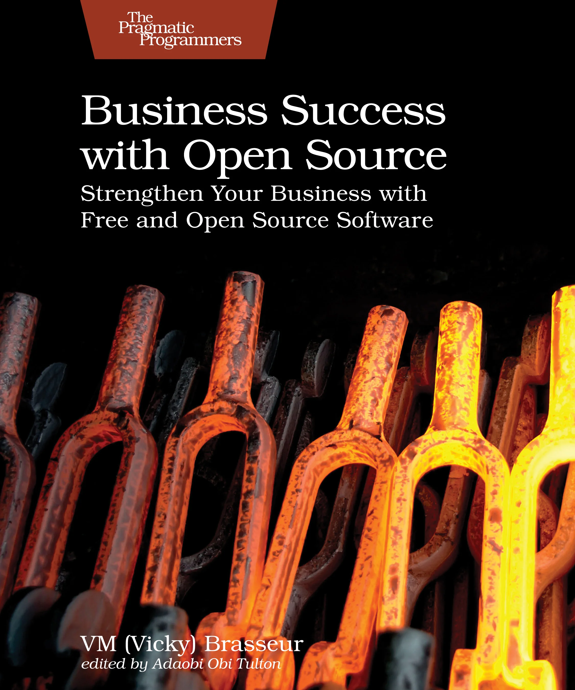
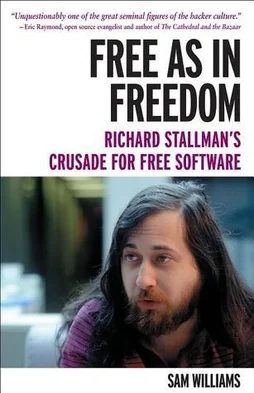
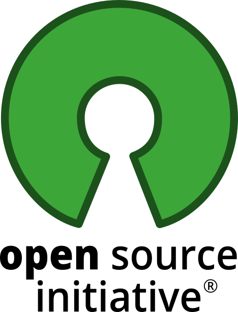
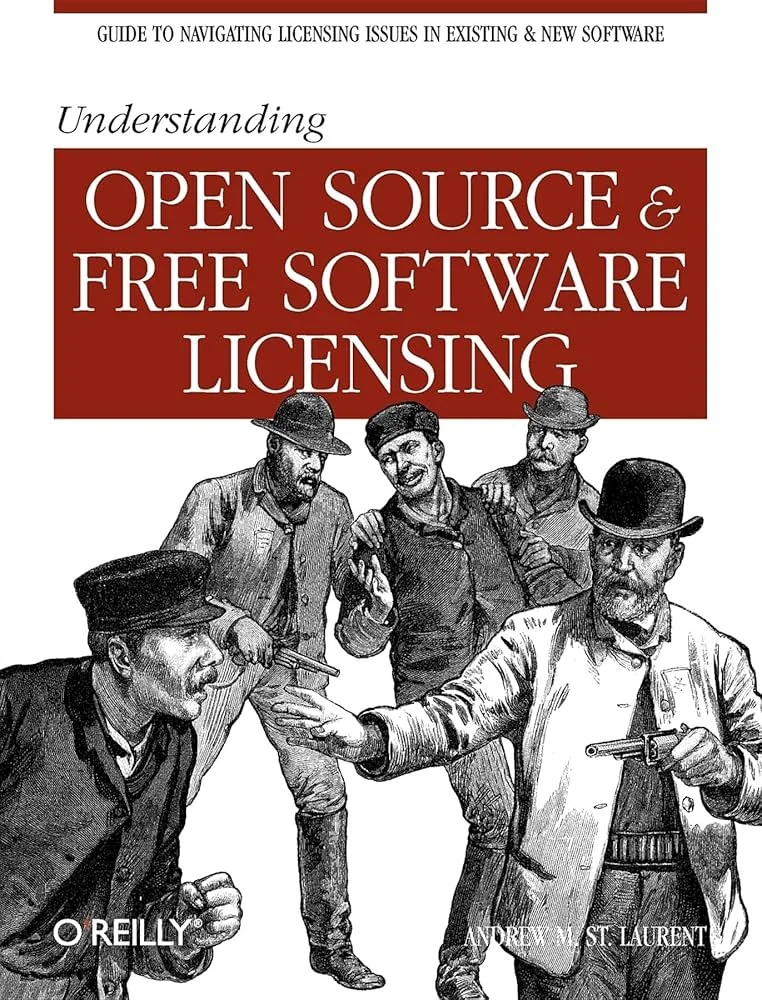
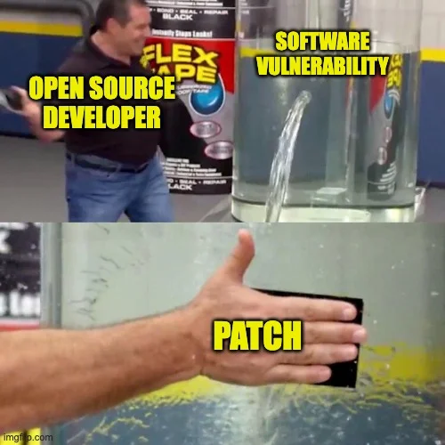
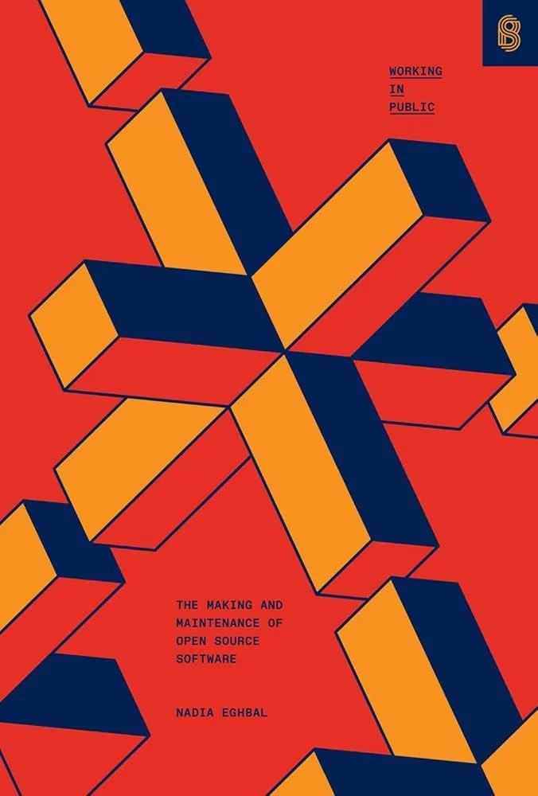
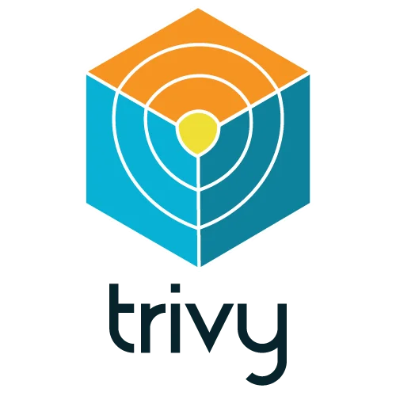
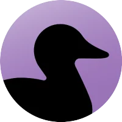

---
format:
  revealjs:
    css: style.css
    theme: dracula
    revealjs-plugins:
      - a11y
    revealjs-a11y:
      # 0.2.3's menus introduce ARIA failures; retain our slide-menu handling.
      slide-menu-a11y: false
      menu: false
      # Use the extension's core accessibility fixes without extra UI/shortcuts.
      font-size-controls: false
      font-selection: false
      text-spacing: false
      transcript: false
      slide-change-cue: false
    slide-number: true
    code-line-numbers: false
    preview-links: auto
    keyboard: true
    touch: true
    help: true
    include-in-header: meta-tags.html
    include-after-body: accessibility.html
    link-external-newwindow: true
execute:
  echo: true
  eval: false
keywords: ["FOSS", "open-source", "enterprise", "software-licensing", "security"]
description-meta: "Understanding Free and Open Source Software for enterprise: licences, risks, and automated tools for managing open source dependencies."
license: "CC0 1.0 Universal"
pagetitle: "FOSS for Enterprise"
author-meta: "Indrajeet Patil"
date-meta: "2025-12-05"
lang: "en"
dir: "ltr"
image: "media/dependency.webp"
image-alt: "FOSS for Enterprise - Software dependency illustration from xkcd"
canonical-url: "https://www.indrapatil.com/foss-for-enterprise/"
jupyter: python3
---

## FOSS for Enterprise {style="margin-top: 2em; margin-bottom: 1em;"}

:::: {.columns}

::: {.column width="60%"}

::: {style="margin-top: 1em; margin-bottom: 1em;"}

::: {style="font-size: 0.9em; font-weight: bold;"}
Understanding Open Source Licences, Risks, and Compliance
:::

::: {style="font-size: 0.8em; margin-top: 1em;"}
Indrajeet Patil
:::

:::

:::

::: {.column width="40%"}

::: {style="text-align: center;"}
{width="400" height="400" fig-alt="xkcd comic showing modern digital infrastructure precariously balanced on a small project maintained by one person since 2003"}
:::

::: {style="text-align: center; font-size: 0.4em; margin-top: -7px;"}
([xkcd](https://xkcd.com/2347/), CC BY-NC 2.5)
:::

:::

::::

::: {style="text-align: center; font-size: 0.5em; color: #c7c7cf;"}
Source code for these slides can be found on [GitHub](https://github.com/IndrajeetPatil/foss-for-enterprise/){style="text-decoration: underline;"}
:::

::: {.notes}
Introduce the presentation: Free and Open Source Software (FOSS) is the undisputed bedrock of modern enterprise infrastructure, yet navigating its legal, security, and supply-chain complexities requires deliberate governance.

The objective today is to demystify open-source licences, examine critical enterprise risks, and explore automated tools that safeguard organisations without stifling developer velocity.
:::

## What you'll learn today {.smaller}

:::: {.columns}

::: {.column width="60%"}

- FOSS licensing history and philosophies
- Legal implications and compliance requirements
- Enterprise risks: security, sustainability, and violations
- Automated tools for managing open source dependencies

::: {style="background-color: #44475a; padding: 20px; border-radius: 15px; margin-top: 20px; border: 3px solid #ffb86c; color: #f8f8f2;"}

::: {style="text-align: center; font-size: 1.1em; font-weight: bold; color: #ffb86c; margin-bottom: 12px;"}
Scope
:::

::: {style="font-size: 0.8em; line-height: 1.6;"}
✅ **Inbound FOSS** • Using open source in your products<br>
❌ **Outbound FOSS** • Releasing your code as open source
:::

:::

:::

::: {.column width="40%"}

::: {style="text-align: center;"}
{width="100%" fig-alt="Visual representation of FOSS concepts"}
:::

:::

::::

::: {style="background-color: #44475a; padding: 15px; border-radius: 15px; text-align: center; border: 2px solid #ff5555; color: #f8f8f2; margin-top: 20px; font-size: 0.85em;"}

**Disclaimer:** Educational purposes only. Not legal advice.

:::

::: {.notes}
Outline the agenda for the talk:
1. FOSS Licensing: The historical movements, philosophies, and the fundamental differences between permissive and copyleft licences.
2. Legal Aspects: When licence obligations trigger, focusing on distribution versus internal use.
3. Enterprise Risks: Compliance failures, security vulnerabilities, and maintainer sustainability crises with real-world case studies.
4. Automated Tools: Software Composition Analysis (SCA) solutions like Trivy and Black Duck, and how to embed them into CI/CD pipelines.
5. The Value Proposition: Why FOSS remains essential and how sensible governance unlocks its full value.
:::

# FOSS Licensing

::: {.notes}
Introduce the first major section: understanding software licences, copyright foundations, and the core philosophies shaping open-source software.
:::

## The FOSS Movement {.smaller}

::: {style="display: flex; gap: 20px;"}

::: {.fragment style="flex: 1; background-color: #44475a; padding: 10px; border-radius: 8px; border: 2px solid #8be9fd; color: #f8f8f2; font-size: 0.7em;"}

::: {style="text-align: center; font-weight: bold; font-size: 1.2em; margin-bottom: 5px;"}
Free Software
:::

::: {style="text-align: center;"}
{width="200" fig-alt="Book cover: Free as in Freedom - Richard Stallman's Crusade for Free Software by Sam Williams"}
:::

**Free Software Foundation (1985)**

::: {style="font-weight: bold; margin-top: 8px; margin-bottom: 5px;"}
Four Freedoms:
:::
Run, study, modify, share

:::

::: {.fragment style="flex: 1; background-color: #44475a; padding: 10px; border-radius: 8px; border: 2px solid #bd93f9; color: #f8f8f2; font-size: 0.7em;"}

::: {style="text-align: center; font-weight: bold; font-size: 1.2em; margin-bottom: 5px;"}
Open Source
:::

::: {style="text-align: center;"}
{width="160" fig-alt="OSI logo"}
:::

**Open Source Initiative (1998)**

::: {style="font-weight: bold; margin-top: 8px; margin-bottom: 5px;"}
Open Source Definition:
:::
10 criteria (non-discrimination, licence distribution, technology-neutrality)

:::

:::

::: {.notes}
Explain the history and evolution of the FOSS movement:
- Richard Stallman and the Free Software movement (FSF, 1985): focused on user freedoms (the four essential freedoms) and philosophical rights.
- The Open Source Initiative (OSI, 1998): reframed the movement around pragmatic benefits—peer review, reliability, security, and collaborative development.
- Key takeaway: While both advocate for source code access, Free Software prioritises user liberty, whereas Open Source emphasises practical collaboration.
:::

## What are software licences? {.smaller}

::: {style="display: flex; gap: 20px; align-items: center;"}

::: {style="flex: 0 0 65%;"}

Different aspects of software are protected by different types of intellectual property law.

```{mermaid}
%%| eval: true
%%| echo: false
flowchart TD
    IP[Intellectual Property]
    IP --> Ideas[Idea]
    IP --> Expression[Expression of Idea]

    Ideas --> Patent[Patent<br/>Inventions & processes]
    Ideas --> Trademark[Trademark<br/>Brands & symbols]

    Expression --> Copyright[Copyright<br/>Original creative works<br/>Source code]

    style IP fill:#44475a,stroke:#f8f8f2,color:#f8f8f2
    style Ideas fill:#6c6c6c,stroke:#999999,color:#f8f8f2
    style Expression fill:#50fa7b,stroke:#f8f8f2,color:#282a36,stroke-width:3px
    style Patent fill:#3a3a3a,stroke:#666666,color:#bdbdbd
    style Trademark fill:#3a3a3a,stroke:#666666,color:#bdbdbd
    style Copyright fill:#50fa7b,stroke:#f8f8f2,color:#282a36,stroke-width:4px

    linkStyle 0 stroke:#666666,stroke-width:2px
    linkStyle 1 stroke:#50fa7b,stroke-width:3px
    linkStyle 2 stroke:#666666,stroke-width:1px
    linkStyle 3 stroke:#666666,stroke-width:1px
    linkStyle 4 stroke:#50fa7b,stroke-width:3px
```

:::

::: {style="flex: 0 0 35%; text-align: center;"}

::: {style="background-color: #44475a; padding: 20px; border-radius: 15px; margin-bottom: 15px; border: 2px solid #8be9fd; color: #f8f8f2; font-size: 0.85em; text-align: center;"}

**Software licence:** Legal instrument governing use, modification, and distribution of software

:::

{width="250" fig-alt="Book cover: Understanding Open Source & Free Software Licensing by Andrew M. St. Laurent"}

:::

:::

::: {.notes}
Define what software licences are in legal terms:
Software without a licence is not public domain; copyright automatically reserves all rights to the author.

A licence is a legal contract granting specific permissions to use, modify, and distribute the software under defined conditions, limitations, and warranties.
:::

## Movements ↔ Licence Philosophies {.smaller}

::: {style="font-size: 0.8em;"}

| **Aspect**          | **Reciprocal (Copyleft)**                  | **Permissive**                          |
|---------------------|--------------------------------------------|-----------------------------------------|
| **Origin**          | Free Software Movement                     | Open Source Initiative                  |
| **Philosophy**      | Preserve freedom for all users             | Maximum freedom to developers           |
| **Key Feature**     | Derivatives must use same licence          | Minimal restrictions                    |
| **Examples**        | GPL, AGPL, MPL                             | MIT, BSD, Apache                        |
| **Goal**            | Ensure software remains free               | Enable broad adoption and use           |

:::

<br>

::: {style="font-weight: bold; font-size: 1.05em; margin-bottom: 12px; text-align: center;"}
Licence Combination Examples:
:::

::: {style="display: flex; gap: 20px; justify-content: center;"}

::: {style="flex: 1; background-color: #44475a; padding: 18px; border-radius: 10px; border: 2px solid #8be9fd; color: #f8f8f2; text-align: center;"}

::: {style="display: flex; flex-direction: column; align-items: center; gap: 12px;"}

::: {style="display: flex; align-items: center; justify-content: center; gap: 20px;"}
::: {style="width: 60px; text-align: center;"}
{width="40" fig-alt="Chain link icon" style="vertical-align: middle;"}
:::
::: {style="width: 30px; text-align: center; font-size: 1.2em; font-weight: bold;"}
+
:::
::: {style="width: 60px; text-align: center;"}
{width="40" fig-alt="Code icon" style="vertical-align: middle;"}
:::
::: {style="width: 30px; text-align: center; font-size: 1.2em; font-weight: bold;"}
=
:::
::: {style="width: 60px; text-align: center;"}
{width="40" fig-alt="Chain link icon" style="vertical-align: middle;"}
:::
:::

::: {style="display: flex; align-items: center; justify-content: center; gap: 20px; font-size: 0.75em; color: #8be9fd; width: 100%;"}
::: {style="width: 60px; text-align: center;"}
Copyleft
:::
::: {style="width: 30px; text-align: center;"}
:::
::: {style="width: 60px; text-align: center;"}
Custom
:::
::: {style="width: 30px; text-align: center;"}
:::
::: {style="width: 60px; text-align: center;"}
**Copyleft**
:::
:::

:::

:::

::: {style="flex: 1; background-color: #44475a; padding: 18px; border-radius: 10px; border: 2px solid #bd93f9; color: #f8f8f2; text-align: center;"}

::: {style="display: flex; flex-direction: column; align-items: center; gap: 12px;"}

::: {style="display: flex; align-items: center; justify-content: center; gap: 20px;"}
::: {style="width: 60px; text-align: center;"}
{width="40" fig-alt="Open hands icon" style="vertical-align: middle;"}
:::
::: {style="width: 30px; text-align: center; font-size: 1.2em; font-weight: bold;"}
+
:::
::: {style="width: 60px; text-align: center;"}
{width="40" fig-alt="Code icon" style="vertical-align: middle;"}
:::
::: {style="width: 30px; text-align: center; font-size: 1.2em; font-weight: bold;"}
=
:::
::: {style="width: 60px; text-align: center;"}
{width="40" fig-alt="Choice icon" style="vertical-align: middle;"}
:::
:::

::: {style="display: flex; align-items: center; justify-content: center; gap: 20px; font-size: 0.75em; color: #d2b5ff; width: 100%;"}
::: {style="width: 60px; text-align: center;"}
Permissive
:::
::: {style="width: 30px; text-align: center;"}
:::
::: {style="width: 60px; text-align: center;"}
Custom
:::
::: {style="width: 30px; text-align: center;"}
:::
::: {style="width: 60px; text-align: center;"}
**Any Licence**
:::
:::

:::

:::

:::

::: {.notes}
Contrast the two predominant licence philosophies:
- Permissive licences (MIT, Apache 2.0, BSD): Maximise adoption by imposing minimal conditions. Anyone can incorporate the code into proprietary commercial products, usually requiring only attribution and warranty disclaimers.
- Copyleft licences (GPL, LGPL, AGPL): Protect software reciprocity. They require derivative works to be released under the same licence, preventing proprietary closed-source capture.
:::

# Legal Aspects

::: {.notes}
Introduce the legal aspects of open source: exploring trigger events and jurisdictional considerations.
:::

## When do licences matter? {.smaller}

::: {style="background-color: #44475a; padding: 20px; border-radius: 15px; margin: 15px 0; text-align: center; font-size: 1.1em; border: 2px solid #ffb86c; color: #f8f8f2;"}

Licence obligations are triggered by **distribution**

:::

. . .

::: {style="background-color: #44475a; padding: 15px; border-radius: 10px; margin: 15px 0; text-align: center; border: 2px solid #50fa7b; color: #f8f8f2;"}

**Internal use** within your organization is generally **NOT** distribution

:::

. . .

::: {style="font-weight: bold; font-size: 1.1em; margin-bottom: 10px;"}
Examples:
:::

:::: {.columns}

::: {.column width="50%" .fragment}

::: {style="font-weight: bold; font-size: 1.05em; color: #ff8585; margin-bottom: 8px;"}
IS distribution:
:::

- Imaging software in shipped microscopes
- Control software bundled with lithography systems
- Lens design software for opticians

:::

::: {.column width="50%" .fragment}

::: {style="font-weight: bold; font-size: 1.05em; color: #50fa7b; margin-bottom: 8px;"}
NOT distribution:
:::

- Internal development/testing tools
- Web services on internal servers
- R&D prototypes used internally

:::

::::

::: {.notes}
Clarify the critical distinction between internal use and software distribution:
- Internal use: Deploying software solely within an organisation's internal infrastructure rarely triggers copyleft obligations under standard GPLv2 or GPLv3 licences.
- Distribution: Shipping software to clients, selling embedded hardware appliances, or distributing client-side mobile apps constitutes distribution, triggering mandatory source code disclosure for copyleft dependencies.
- Note the AGPL requirement: Section 13 of the Affero GPL closes the SaaS loophole by requiring organisations that run a modified version on a server to offer the Corresponding Source to users interacting with it remotely over a network. Hosting an unmodified AGPL program does not trigger this obligation.
:::

# Enterprise Risks

::: {.notes}
Introduce the core risks enterprises face when consuming open-source software without systematic oversight.
:::

## Lack of awareness and compliance {.smaller}

::: {style="display: flex; gap: 20px;"}

::: {.fragment style="flex: 1; background-color: #44475a; padding: 12px; border-radius: 10px; border: 2px solid #ffb86c; color: #f8f8f2; font-size: 0.8em;"}

::: {style="font-weight: bold; font-size: 1.15em; margin-bottom: 10px; color: #ffb86c;"}
Common issues:
:::

- Dependencies added unknowingly
- Transitive dependencies unnoticed
- Licence obligations misunderstood
- No component inventory

:::

::: {.fragment style="flex: 1; background-color: #44475a; padding: 12px; border-radius: 10px; border: 2px solid #ff5555; color: #f8f8f2; font-size: 0.8em;"}

::: {style="font-weight: bold; font-size: 1.15em; margin-bottom: 10px; color: #ff8585;"}
Non-compliance consequences:
:::

- Copyright infringement lawsuits
- Forced source code disclosure
- Product sales injunctions
- Reputational damage
- Financial penalties

:::

:::

<br>

. . .

::: {style="background-color: #44475a; padding: 15px; border-radius: 10px; border: 2px solid #bd93f9; color: #f8f8f2; font-size: 0.7em;"}

**Licence changes can break your business:**

Major FOSS projects have switched licences, forcing companies to pay or migrate:

- [Redis](https://techcrunch.com/2024/03/21/redis-switches-licenses-acquires-speedb-to-go-beyond-its-core-in-memory-database/) (BSD → SSPL/RSALv2, 2024)
- [Elasticsearch](https://www.elastic.co/blog/licensing-change) (Apache 2.0 → SSPL, 2021)
- [MongoDB](https://techcrunch.com/2018/10/16/mongodb-switches-up-its-open-source-license/) (AGPL → SSPL, 2018)

**Lesson:** Monitor upstream licence changes actively!

:::

::: {.notes}
Discuss the risk of licence ignorance and non-compliance:
Developers frequently copy code snippets from public forums or pull in deep dependency trees without checking transitive licences.

Non-compliance exposes companies to copyright infringement claims, forced source disclosure, injunctions halting product sales, and reputational damage.
:::

## Case Studies: Licence Violations {.smaller}

**Famous legal battles involving FOSS licence infringement:**

::: {style="display: flex; gap: 15px; justify-content: space-between;"}

::: {.fragment style="flex: 1; background-color: #44475a; padding: 15px; border-radius: 10px; border: 2px solid #8be9fd; color: #f8f8f2; font-size: 0.75em; display: flex; flex-direction: column;"}

::: {style="text-align: center;"}
{width="60" fig-alt="Legal gavel icon"}
:::

::: {style="font-size: 1.2em; font-weight: bold; text-align: center; margin-top: 8px; margin-bottom: 8px;"}
[VMware vs. Hellwig](https://sfconservancy.org/copyleft-compliance/vmware-lawsuit-faq.html)
:::

::: {style="background-color: #8be9fd; color: #282a36; padding: 4px 8px; border-radius: 5px; text-align: center; font-weight: bold; margin-bottom: 10px; font-size: 0.9em;"}
Germany • Dismissed
:::

::: {style="flex-grow: 1;"}
Linux developer sued VMware for GPL violation. VMware ultimately removed problematic component.
:::

**Takeaway:** Dismissed cases can still force compliance

:::

::: {.fragment style="flex: 1; background-color: #44475a; padding: 15px; border-radius: 10px; border: 2px solid #bd93f9; color: #f8f8f2; font-size: 0.75em; display: flex; flex-direction: column;"}

::: {style="text-align: center;"}
{width="60" fig-alt="Court ruling icon"}
:::

::: {style="font-size: 1.2em; font-weight: bold; text-align: center; margin-top: 8px; margin-bottom: 8px;"}
[Artifex vs. Hancom](https://www.fsf.org/blogs/licensing/update-on-artifex-v-hancom-gnu-gpl-compliance-case-1)
:::

::: {style="background-color: #d2b5ff; color: #282a36; padding: 4px 8px; border-radius: 5px; text-align: center; font-weight: bold; margin-bottom: 10px; font-size: 0.9em;"}
USA • Settled
:::

::: {style="flex-grow: 1;"}
U.S. court ruled GPL is enforceable contract. Landmark Ghostscript case.
:::

**Takeaway:** GPL licences are legally binding contracts

:::

::: {.fragment style="flex: 1; background-color: #44475a; padding: 15px; border-radius: 10px; border: 2px solid #ffb86c; color: #f8f8f2; font-size: 0.75em; display: flex; flex-direction: column;"}

::: {style="text-align: center;"}
{width="60" fig-alt="Multiple lawsuits icon"}
:::

::: {style="font-size: 1.2em; font-weight: bold; text-align: center; margin-top: 8px; margin-bottom: 8px;"}
[BusyBox Lawsuits](https://web.archive.org/web/20201222143328/https://www.softwarefreedom.org/news/2009/dec/14/busybox-gpl-lawsuit/)
:::

::: {style="background-color: #ffb86c; color: #282a36; padding: 4px 8px; border-radius: 5px; text-align: center; font-weight: bold; margin-bottom: 10px; font-size: 0.9em;"}
USA • Multiple Settlements
:::

::: {style="flex-grow: 1;"}
First U.S. GPL enforcement lawsuits vs. Verizon, Best Buy, Samsung, and others.
:::

**Takeaway:** Big names aren't immune to enforcement

:::

:::

::: {.notes}
Walk through historical case studies of licence enforcement:
- Free Software Foundation vs. Cisco (Linksys WRT54G): Cisco acquired Linksys and distributed Linux-based firmware without publishing source code. The FSF sued, forcing Cisco to release complete build scripts and establish internal compliance processes.
- Artifex vs. Hancom: A US federal court affirmed that open-source licences are legally binding contracts enforceable in court.
:::

## Security vulnerabilities {.smaller}

:::: {.columns}

::: {.column width="60%" .fragment}

::: {style="background-color: #44475a; padding: 15px; border-radius: 10px; margin-bottom: 15px; border: 2px solid #ff5555; color: #f8f8f2;"}

::: {style="font-weight: bold; font-size: 1.15em; margin-bottom: 10px; color: #ff8585;"}
Common security risks:
:::

- Outdated packages with known CVEs
- Unpatched critical vulnerabilities
- Supply chain attacks

:::

::: {style="background-color: #44475a; padding: 15px; border-radius: 10px; border: 2px solid #ffb86c; color: #f8f8f2; font-size: 0.8em;"}

::: {style="font-weight: bold; font-size: 1.15em; margin-bottom: 10px; color: #ffb86c;"}
CVEs can enable:
:::

- **Remote Code Execution** - Run arbitrary code
- **Data Exfiltration** - Access sensitive data
- **Denial of Service** - Crash or disable systems

:::

:::

::: {.column width="40%" .fragment}

::: {style="text-align: center;"}
{fig-alt="Meme showing open source developer applying a patch to fix software vulnerability (Flex Seal format)"}
:::

:::

::::

::: {.notes}
Examine security vulnerabilities in open-source dependencies:
Enterprises do not just inherit the top-level libraries they declare; they inherit the entire transitive graph of third-party dependencies.

Common Vulnerabilities and Exposures (CVEs) in widely used packages create pervasive, systemic exposure across hundreds of thousands of downstream applications.
:::

## Case Studies: Vulnerabilities {.smaller}

**The cost of failing to patch FOSS vulnerabilities:**

::: {style="display: flex; gap: 15px; justify-content: space-between;"}

::: {.fragment style="flex: 1; background-color: #44475a; padding: 15px; border-radius: 10px; border: 2px solid #ff5555; color: #f8f8f2; font-size: 0.75em; display: flex; flex-direction: column;"}

::: {style="text-align: center;"}
{width="60" fig-alt="Security breach icon"}
:::

::: {style="font-size: 1.2em; font-weight: bold; text-align: center; margin-top: 8px; margin-bottom: 8px;"}
[Equifax Breach (2017)](https://en.wikipedia.org/wiki/2017_Equifax_data_breach)
:::

::: {style="background-color: #ff8585; color: #282a36; padding: 4px 8px; border-radius: 5px; text-align: center; font-weight: bold; margin-bottom: 10px; font-size: 0.9em;"}
Unpatched Apache Struts
:::

::: {style="flex-grow: 1;"}
150M+ people affected. Patch available 2 months before breach. Cost: $575M settlement.
:::

**Takeaway:** Delaying patches costs hundreds of millions

:::

::: {.fragment style="flex: 1; background-color: #44475a; padding: 15px; border-radius: 10px; border: 2px solid #bd93f9; color: #f8f8f2; font-size: 0.75em; display: flex; flex-direction: column;"}

::: {style="text-align: center;"}
{width="60" fig-alt="Critical vulnerability icon"}
:::

::: {style="font-size: 1.2em; font-weight: bold; text-align: center; margin-top: 8px; margin-bottom: 8px;"}
[Log4Shell (2021)](https://en.wikipedia.org/wiki/Log4Shell)
:::

::: {style="background-color: #d2b5ff; color: #282a36; padding: 4px 8px; border-radius: 5px; text-align: center; font-weight: bold; margin-bottom: 10px; font-size: 0.9em;"}
CVSS 10/10 Critical
:::

::: {style="flex-grow: 1;"}
Apache Log4j vulnerability. CISA: "most serious in my career". Hundreds of millions of devices vulnerable. Half of corporate networks probed.
:::

**Takeaway:** Ubiquitous library = ubiquitous vulnerability

:::

::: {.fragment style="flex: 1; background-color: #44475a; padding: 15px; border-radius: 10px; border: 2px solid #ffb86c; color: #f8f8f2; font-size: 0.75em; display: flex; flex-direction: column;"}

::: {style="text-align: center;"}
{width="60" fig-alt="Heartbeat icon"}
:::

::: {style="font-size: 1.2em; font-weight: bold; text-align: center; margin-top: 8px; margin-bottom: 8px;"}
[Heartbleed (2014)](https://en.wikipedia.org/wiki/Heartbleed)
:::

::: {style="background-color: #ffb86c; color: #282a36; padding: 4px 8px; border-radius: 5px; text-align: center; font-weight: bold; margin-bottom: 10px; font-size: 0.9em;"}
OpenSSL Memory Leak
:::

::: {style="flex-grow: 1;"}
17% of SSL servers affected (Yahoo, GitHub). Bug existed since 2011, disclosed 2014. Undermined Internet security foundations.
:::

**Takeaway:** Encryption bugs expose everyone's secrets

:::

:::

::: {.notes}
Discuss prominent real-world security vulnerabilities:
- Log4Shell (CVE-2021-44228): A critical JNDI remote code execution vulnerability in `log4j-core` that affected vulnerable Log4j deployments across numerous enterprise systems.
- Heartbleed (CVE-2014-0160): A catastrophic buffer over-read in OpenSSL that allowed attackers to extract cryptographic private keys from active server memory.
:::

## Sustainability risks {.smaller}

:::: {.columns}

::: {.column width="60%" .fragment}

::: {style="background-color: #44475a; padding: 15px; border-radius: 10px; margin-bottom: 15px; border: 2px solid #bd93f9; color: #f8f8f2; font-size: 0.8em;"}

::: {style="font-weight: bold; font-size: 1.15em; margin-bottom: 10px; color: #d2b5ff;"}
Common sustainability issues:
:::

- Maintainer burnout and underfunding
- Abandoned or undermaintained projects
- Toxic communities

:::

::: {style="background-color: #44475a; padding: 15px; border-radius: 10px; border: 2px solid #ff5555; color: #f8f8f2; font-size: 0.8em;"}

::: {style="font-weight: bold; font-size: 1.15em; margin-bottom: 10px; color: #ff8585;"}
Business impact:
:::

- No security patches or bug fixes
- Forced migration to alternatives
- Reputation damage from toxic projects

:::

:::

::: {.column width="40%"}

::: {style="text-align: center;"}
{width="280" fig-alt="Book cover: Working in Public by Nadia Eghbal"}
:::

:::

::::

. . . 

::: {style="background-color: #44475a; padding: 12px; border-radius: 10px; border: 2px solid #ffb86c; color: #f8f8f2; font-size: 0.75em; margin-top: 15px; text-align: center;"}

::: {style="font-weight: bold; font-size: 1.15em; margin-bottom: 8px; color: #ffb86c;"}
Critical dependency risk:
:::

FOSS project at your product's heart = its sustainability is **your** sustainability

:::

::: {.notes}
Discuss open-source sustainability and maintainer burnout:
Many critical dependencies rely on small maintainer teams or single individuals.

When maintainers face burnout, financial pressure, or unconstructive demands, critical packages become unmaintained, abandoned, or subject to abrupt licence changes.
:::

## Case Studies: Sustainability Failures {.smaller}

**Real-world examples of FOSS sustainability crises:**

::: {style="display: flex; gap: 15px; justify-content: space-between;"}

::: {.fragment style="flex: 1; background-color: #44475a; padding: 15px; border-radius: 10px; border: 2px solid #ff5555; color: #f8f8f2; font-size: 0.75em; display: flex; flex-direction: column;"}

::: {style="text-align: center;"}
{width="60" fig-alt="Package removal icon"}
:::

::: {style="font-size: 1.2em; font-weight: bold; text-align: center; margin-top: 8px; margin-bottom: 8px;"}
[left-pad (2016)](https://en.wikipedia.org/wiki/Npm_left-pad_incident)
:::

::: {style="background-color: #ff8585; color: #282a36; padding: 4px 8px; border-radius: 5px; text-align: center; font-weight: bold; margin-bottom: 10px; font-size: 0.9em;"}
Package Removal
:::

::: {style="flex-grow: 1;"}
11 lines of code, 15M+ downloads. Maintainer removed after dispute, breaking thousands of projects (React, Babel, Node).
:::

**Takeaway:** Tiny dependencies create massive failure points

:::

::: {.fragment style="flex: 1; background-color: #44475a; padding: 15px; border-radius: 10px; border: 2px solid #bd93f9; color: #f8f8f2; font-size: 0.75em; display: flex; flex-direction: column;"}

::: {style="text-align: center;"}
{width="60" fig-alt="Burnout icon"}
:::

::: {style="font-size: 1.2em; font-weight: bold; text-align: center; margin-top: 8px; margin-bottom: 8px;"}
[core-js (2023)](https://www.theregister.com/2023/02/15/corejs_russia_open_source/)
:::

::: {style="background-color: #d2b5ff; color: #282a36; padding: 4px 8px; border-radius: 5px; text-align: center; font-weight: bold; margin-bottom: 10px; font-size: 0.9em;"}
Burnout & Underfunding
:::

::: {style="flex-grow: 1;"}
9B+ downloads, 50% of top 10k websites. Solo maintainer earns ~$400/month, threatened to go closed-source.
:::

**Takeaway:** Critical infrastructure runs on volunteer labor

:::

::: {.fragment style="flex: 1; background-color: #44475a; padding: 15px; border-radius: 10px; border: 2px solid #ffb86c; color: #f8f8f2; font-size: 0.75em; display: flex; flex-direction: column;"}

::: {style="text-align: center;"}
{width="60" fig-alt="Sabotage icon"}
:::

::: {style="font-size: 1.2em; font-weight: bold; text-align: center; margin-top: 8px; margin-bottom: 8px;"}
[faker.js/colors.js (2022)](https://www.bleepingcomputer.com/news/security/dev-corrupts-npm-libs-colors-and-faker-breaking-thousands-of-apps/)
:::

::: {style="background-color: #ffb86c; color: #282a36; padding: 4px 8px; border-radius: 5px; text-align: center; font-weight: bold; margin-bottom: 10px; font-size: 0.9em;"}
Maintainer Protest
:::

::: {style="flex-grow: 1;"}
3.3B+ downloads. Maintainer sabotaged libraries to protest Fortune 500s using free work without giving back.
:::

**Takeaway:** Frustrated maintainers can become security risks

:::

:::

::: {.notes}
Examine case studies of sustainability failures:
- left-pad (2016): An eleven-line JavaScript package unpublished from npm broke thousands of builds across major tech companies, illustrating extreme transitive dependency fragility.
- colors.js and faker.js (2022): The maintainer deliberately introduced infinite loops and breaking changes after growing frustrated with commercial enterprises exploiting his work without financial compensation.
:::

# Automated Tools

::: {.notes}
Introduce automated tooling and Software Composition Analysis (SCA) as the standard remedy for managing dependency risks at scale.
:::

## Why automate FOSS management? {.smaller}

::: {style="font-size: 0.75em;"}

| **Problem** | **How Automation Helps** |
|-------------|--------------------------|
| Hundreds to thousands of direct dependencies | **Automated discovery** of all FOSS components in codebase |
| Tens of thousands of transitive dependencies | **Dependency mapping** to track entire dependency tree |
| Multiple package managers (npm, pip, Maven, etc.) | **Multi-ecosystem support** across all package managers |
| Constantly evolving vulnerability landscape | **Continuous monitoring** for newly discovered CVEs |
| Unknown licence obligations | **Licence detection** and compliance checking |
| No visibility into component inventory | **SBOM generation** (Software Bill of Materials) |
| Manual tracking doesn't scale | **Automated alerts** and reporting for issues |

:::

::: {.notes}
Explain why automated governance is necessary:
Manual licence audits and spreadsheet tracking are impossible when enterprise codebases contain thousands of transitive dependencies.

Automated SCA tools scan dependency trees, generate Software Bills of Materials (SBOMs), detect CVEs, and enforce organizational licence policies automatically.
:::

## Open Source Tool: Trivy {.smaller}

:::: {.columns}

::: {.column width="70%"}

**[Trivy](https://trivy.dev/)** - Comprehensive security scanner by Aqua Security

- Vulnerability detection
- Licence scanning
- Secret detection
- SBOM generation

**Scan a container image:**

```bash
trivy image nginx:latest
```

::: {style="font-size: 0.85em; margin-top: 10px; font-style: italic;"}
Free, open-source, widely adopted in CI/CD pipelines
:::

:::

::: {.column width="30%"}

::: {style="text-align: center;"}
{width="180" fig-alt="Trivy logo"}
:::

:::

::::

::: {.notes}
Review Trivy as a premier open-source scanner:
Maintained by Aqua Security, Trivy scans container images, filesystems, git repositories, and Kubernetes configurations for vulnerabilities, misconfigurations, and licence compliance.

It is lightweight, fast, and easily integrated into CLI workflows and local developer environments.
:::

## Commercial Tool: Black Duck {.smaller}

:::: {.columns}

::: {.column width="70%"}

**[Black Duck](https://www.blackduck.com/)** - Enterprise-grade SCA platform

- Comprehensive vulnerability management
- Licence compliance automation
- Supply chain risk assessment
- Policy enforcement

**Configuration (application.properties):**

```properties
blackduck.url=https://blackduck.example.com
blackduck.api.token=${BLACKDUCK_TOKEN}
detect.project.name=MyProject
detect.policy.check.fail.on.severities=BLOCKER,CRITICAL
```

::: {style="font-size: 0.85em; margin-top: 10px; font-style: italic;"}
Enterprise support, extensive database, advanced reporting
:::

:::

::: {.column width="30%"}

::: {style="text-align: center;"}
{width="180" fig-alt="Black Duck logo"}
:::

:::

::::

::: {.notes}
Review commercial enterprise solutions, exemplified by Black Duck (Synopsys):
Black Duck provides enterprise-grade scanning, multi-factor licence identification (including snippet and code-matching analysis), automated SBOM generation, and legal policy workflows.

It is tailored for enterprise M&A due diligence, legal compliance departments, and deep software supply chain audits.
:::

## Integrating tools into your workflow {.smaller}

::: {style="background-color: #44475a; padding: 15px; border-radius: 10px; margin: 10px 0; font-size: 0.9em; border: 2px solid #50fa7b; color: #f8f8f2;"}

- **Scan early and often** - Integrate into CI/CD pipeline
- **Set clear policies** - Define acceptable risk levels
- **Automate fixes** - Use dependency update tools (Dependabot, Renovate)
- **Monitor continuously** - New vulnerabilities discovered daily
- **Educate developers** - Make security everyone's responsibility

:::

```{mermaid}
%%| eval: true
%%| echo: false
flowchart LR
    A[Developer commits] --> B[CI/CD Pipeline]
    B --> C[FOSS Scanner]
    C --> D{Vulnerabilities?}
    D -->|Yes| E[Block/Alert]
    D -->|No| F[Deploy]
    E --> G[Create ticket]
    G --> H[Developer fixes]
    H --> A

    classDef default fill:#44475a,stroke:#f8f8f2,color:#f8f8f2
    style C fill:#e3f2fd,color:#282a36
    style E fill:#ffebee,color:#282a36
    style F fill:#e8f5e9,color:#282a36
```

::: {.notes}
Demonstrate how to integrate automated tooling throughout the software development lifecycle:
- In the IDE: Real-time feedback for developers when introducing new libraries.
- Pre-commit & pull requests: Automated checks blocking PRs that introduce forbidden licences or critical CVEs.
- Continuous Integration & Deployment: Automated build gates and regular periodic vulnerability rescanning of production artefacts.
:::

# Worth it?

::: {.notes}
Transition into the business justification: weighing the risks against the benefits of FOSS adoption.
:::

## Is FOSS worth the risk? {.smaller}

:::: {.columns}

::: {.column width="50%"}

::: {style="background-color: #44475a; padding: 20px; border-radius: 15px; margin-bottom: 20px; border: 3px solid #ff5555; color: #f8f8f2;"}

::: {style="text-align: center; font-size: 1.2em; font-weight: bold; color: #ff8585; margin-bottom: 15px;"}
We've seen the risks...
:::

- Licence compliance challenges
- Security vulnerabilities
- Sustainability concerns
- Legal complications

:::

:::

::: {.column width="50%" .fragment}

::: {style="background-color: #44475a; padding: 20px; border-radius: 15px; margin-bottom: 20px; border: 3px solid #50fa7b; color: #f8f8f2;"}

::: {style="text-align: center; font-size: 1.2em; font-weight: bold; color: #50fa7b; margin-bottom: 15px;"}
But the answer is YES! ✓
:::

- Innovation without reinventing
- Massive cost savings
- Battle-tested solutions
- Vibrant ecosystems

:::

:::

::::

::: {.notes}
Address the central question: Is FOSS worth the risk?
The answer is an unequivocal yes. Building proprietary software without open source would require reinvention of operating systems, databases, web servers, and cryptographic libraries.

The goal is not to eliminate open source, but to manage its consumption with the same engineering rigour applied to proprietary code.
:::

## The modern stack is FOSS {.smaller}

::: {style="display: grid; grid-template-columns: repeat(2, 1fr); gap: 20px; margin: 25px 0;"}

::: {style="background: linear-gradient(135deg, #0d7377 0%, #0f766e 100%); padding: 22px; border-radius: 12px; border: 3px solid #8be9fd; color: #ffffff; box-shadow: 0 4px 6px rgba(0,0,0,0.3);"}

::: {style="font-size: 1.4em; font-weight: bold; margin-bottom: 12px; text-align: center; color: #ffffff;"}
🎨 Frontend
:::

::: {style="font-size: 0.9em; text-align: center; line-height: 1.9; color: #f0f9ff;"}
**TypeScript** • **React** • **Vue**<br/>
**Webpack** • **Vite** • **npm**
:::

:::

::: {style="background: linear-gradient(135deg, #047857 0%, #15803d 100%); padding: 22px; border-radius: 12px; border: 3px solid #50fa7b; color: #ffffff; box-shadow: 0 4px 6px rgba(0,0,0,0.3);"}

::: {style="font-size: 1.4em; font-weight: bold; margin-bottom: 12px; text-align: center; color: #ffffff;"}
⚙️ Backend
:::

::: {style="font-size: 0.9em; text-align: center; line-height: 1.9; color: #f0fdf4;"}
**Python** • **Node.js** • **Java**<br/>
**FastAPI** • **Django** • **Express**
:::

:::

::: {style="background: linear-gradient(135deg, #c2410c 0%, #b45309 100%); padding: 22px; border-radius: 12px; border: 3px solid #ffb86c; color: #ffffff; box-shadow: 0 4px 6px rgba(0,0,0,0.3);"}

::: {style="font-size: 1.4em; font-weight: bold; margin-bottom: 12px; text-align: center; color: #ffffff;"}
💾 Data Layer
:::

::: {style="font-size: 0.9em; text-align: center; line-height: 1.9; color: #fffbeb;"}
**PostgreSQL** • **MySQL** • **Redis**<br/>
**MongoDB** • **Kafka** • **Elasticsearch**
:::

:::

::: {style="background: linear-gradient(135deg, #6d28d9 0%, #7c3aed 100%); padding: 22px; border-radius: 12px; border: 3px solid #bd93f9; color: #ffffff; box-shadow: 0 4px 6px rgba(0,0,0,0.3);"}

::: {style="font-size: 1.4em; font-weight: bold; margin-bottom: 12px; text-align: center; color: #ffffff;"}
☁️ Infrastructure
:::

::: {style="font-size: 0.9em; text-align: center; line-height: 1.9; color: #faf5ff;"}
**Docker** • **Kubernetes** • **Linux**<br/>
**Terraform** • **Ansible** • **Git**
:::

:::

:::

::: {style="background-color: #44475a; padding: 25px; border-radius: 15px; border: 3px solid #50fa7b; color: #f8f8f2; text-align: center; font-size: 1em; font-weight: bold; margin-top: 10px;"}

You're already using FOSS everywhere. The question isn't *whether* to use it, but *how to use it safely*.

:::

::: {.notes}
Illustrate that modern enterprise software is already fundamentally open source:
Linux powers cloud infrastructure; Kubernetes orchestrates workloads; PostgreSQL and MySQL store data; Python, Go, and Rust drive application logic.

FOSS is not an alternative to enterprise software; it is the infrastructure upon which enterprise software is constructed.
:::

# Summary

::: {.notes}
Transition into the conclusion: reviewing key takeaways and actionable recommendations.
:::

## Key takeaways {.smaller}

::: {style="background-color: #44475a; padding: 15px; border-radius: 10px; margin: 10px 0; border: 2px solid #8be9fd; color: #f8f8f2;"}

**FOSS is everywhere** - Understand what you're using

:::

::: {style="background-color: #44475a; padding: 15px; border-radius: 10px; margin: 10px 0; border: 2px solid #bd93f9; color: #f8f8f2;"}

**Licences matter** - Know the difference between reciprocal and permissive

:::

::: {style="background-color: #44475a; padding: 15px; border-radius: 10px; margin: 10px 0; border: 2px solid #ffb86c; color: #f8f8f2;"}

**Distribution triggers obligations** - Understand when licences apply

:::

::: {style="background-color: #44475a; padding: 15px; border-radius: 10px; margin: 10px 0; border: 2px solid #ff5555; color: #f8f8f2;"}

**Security is critical** - Don't be the next Equifax

:::

::: {style="background-color: #44475a; padding: 15px; border-radius: 10px; margin: 10px 0; border: 2px solid #50fa7b; color: #f8f8f2;"}

**Automate everything** - Use tools like Trivy or Black Duck

:::

::: {.notes}
Summarise the key takeaways:
- Know what you use: Maintain an accurate, living inventory and SBOM for all applications.
- Understand your obligations: Establish clear internal policies distinguishing permissible licences from high-risk copyleft dependencies.
- Automate detection: Embed SCA tools into CI/CD pipelines to catch vulnerabilities and licence violations before code reaches production.
- Give back: Support critical open-source projects through sponsorships, bug reports, and upstream contributions to sustain the ecosystem.
:::

# Thank You

Happy FOSSing! 😊

<br>

::: {style="text-align: center; font-size: 0.7em;"}

Check out my other [slide decks](https://www.indrapatil.com/presentations/) on software development best practices

:::

::: {style="text-align: center; font-size: 1em;"}

<a class="deck-icon-link" href="https://www.linkedin.com/in/indrajeet-patil-ph-d-397865174/" aria-label="LinkedIn"><span class="deck-icon deck-icon-brands-linkedin" aria-hidden="true"></span></a>
&nbsp;&nbsp;
<a class="deck-icon-link" href="https://github.com/IndrajeetPatil" aria-label="GitHub"><span class="deck-icon deck-icon-brands-github" aria-hidden="true"></span></a>
&nbsp;&nbsp;
<a class="deck-icon-link" href="mailto:patilindrajeet.science@gmail.com" aria-label="Email"><span class="deck-icon deck-icon-solid-envelope" aria-hidden="true"></span></a>

:::

::: {.notes}
Conclude the presentation, thank the audience for their time, and open the floor to questions and discussion.
:::

## References {.smaller data-visibility="uncounted"}

:::{style="font-size: 25px;"}

- Free Software Foundation. "What is Free Software?" <https://www.gnu.org/philosophy/free-sw.html>

- Open Source Initiative. "The Open Source Definition." <https://opensource.org/osd>

- GNU Project. "GNU General Public License v2.0." <https://www.gnu.org/licenses/old-licenses/gpl-2.0.html>

- Open Source Initiative. "MIT License." <https://opensource.org/licenses/MIT>

- U.S. House of Representatives. "The Equifax Data Breach Report." December 2018.

- Aqua Security. "Trivy Documentation." <https://aquasecurity.github.io/trivy/>

- Black Duck. "Black Duck Documentation." <https://docs.blackduck.com/>

- Choose a License. <https://choosealicense.com/>

- TLDRLegal. "Software Licenses in Plain English." <https://www.tldrlegal.com/>

:::

::: {.notes}
Provide references, official licence texts, and reading recommendations for attendees seeking to explore FOSS legal frameworks and security tooling further.
:::
